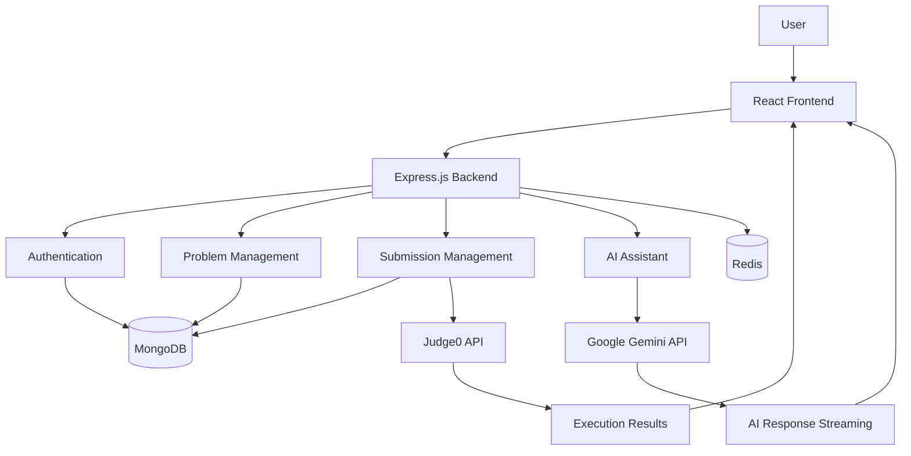

# 🚀 AiCodezy – AI-Powered Coding Practice Platform

AiCodezy is a full-stack coding practice platform designed to help developers improve their Data Structures and Algorithms (DSA) skills through hands-on coding, real-time code execution, and AI-powered assistance.

It provides an interactive coding environment where users can solve problems, run code against test cases, submit solutions, track their progress, and get personalized guidance from an AI assistant.

🔗 **Live Demo:** [https://ai-codezy.vercel.app](https://ai-codezy.vercel.app)

---

## 📸 Screenshots

### 1. Home Page


### 2. Problems Dashboard


### 3. Coding Workspace


### 4. AI Coding Assistant


### 5. Code Execution Results


### 6. Submission History


---

## ✨ Features

- **User Authentication:** Secure signup and login functionality.
- **Problem Library:** Browse and practice a collection of DSA problems.
- **Monaco Code Editor:** Write and edit code in an interactive coding environment.
- **Multi-Language Support:** Solve problems using multiple programming languages.
- **Code Execution:** Run code against visible test cases and get instant feedback.
- **Code Submission:** Submit solutions against visible and hidden test cases.
- **Submission History:** Track previous submissions and their results.
- **Solved Problems Tracking:** Keep track of successfully solved problems.
- **AI Coding Assistant:** Get AI-powered hints, explanations, debugging help, and problem-specific guidance.
- **Daily Problems:** Practice regularly with daily coding challenges.
- **Editorials and Solutions:** Access problem explanations and solution resources.

---

## 🏗️ System Architecture



---


---

## 📂 Project Structure

```text
AiCodezy/
│
├── Frontened/
│   ├── public/
│   ├── src/
│   │   ├── auth/
│   │   │   ├── authPage.jsx
│   │   │   ├── signIn.jsx
│   │   │   └── signUp.jsx
│   │   │
│   │   ├── components/
│   │   │   ├── answer.jsx
│   │   │   ├── askAI.jsx
│   │   │   ├── codeEditor.jsx
│   │   │   ├── dailyProblem.jsx
│   │   │   ├── description.jsx
│   │   │   ├── dsaVisualize.jsx
│   │   │   ├── editorial.jsx
│   │   │   ├── features.jsx
│   │   │   ├── footer.jsx
│   │   │   ├── hero.jsx
│   │   │   ├── solutions.jsx
│   │   │   ├── submissions.jsx
│   │   │   ├── testCaseResults.jsx
│   │   │   └── testCases.jsx
│   │   │
│   │   ├── pages/
│   │   │   ├── allProblems.jsx
│   │   │   ├── Home.jsx
│   │   │   ├── navbar.jsx
│   │   │   └── problemPage.jsx
│   │   │
│   │   ├── redux/
│   │   │   ├── aiChatslicer.js
│   │   │   ├── authSlicer.js
│   │   │   ├── dailyproblemSlicer.js
│   │   │   ├── problemSlicer.js
│   │   │   ├── problemSolvedslicer.js
│   │   │   ├── runsSlicer.js
│   │   │   └── submitSlicer.js
│   │   │
│   │   ├── shimmers/
│   │   │   ├── dailyProblemShimmer.jsx
│   │   │   ├── ProblemPageShimmer.jsx
│   │   │   ├── problemsshimmer.jsx
│   │   │   └── submissionShimmer.jsx
│   │   │
│   │   ├── store/
│   │   │   └── store.js
│   │   │
│   │   ├── Ui/
│   │   │   ├── celebrateAnimation.jsx
│   │   │   ├── cursor.jsx
│   │   │   ├── floatingBg.jsx
│   │   │   ├── loadingdots.jsx
│   │   │   ├── logo.jsx
│   │   │   └── particleBurst.jsx
│   │   │
│   │   ├── utils/
│   │   │   └── axiosClient.js
│   │   │
│   │   ├── App.jsx
│   │   ├── index.jsx
│   │   └── index.css
│   │
│   ├── index.html
│   ├── package.json
│   ├── tailwind.config.js
│   └── vite.config.js
│
├── server/
│   ├── src/
│   │   ├── config/
│   │   │   ├── db.js
│   │   │   └── redis.js
│   │   │
│   │   ├── controllers/
│   │   │   ├── aiChatController.js
│   │   │   ├── auth.js
│   │   │   ├── problemController.js
│   │   │   ├── submitController.js
│   │   │   └── videoSolutionCont.js
│   │   │
│   │   ├── middleware/
│   │   │   ├── adminmiddleware.js
│   │   │   └── tokenverify.js
│   │   │
│   │   ├── models/
│   │   │   ├── Problem.js
│   │   │   ├── submission.js
│   │   │   ├── user.js
│   │   │   └── videoSoltuion.js
│   │   │
│   │   ├── routes/
│   │   │   ├── aiChatRouter.js
│   │   │   ├── problemRouter.js
│   │   │   ├── submitProblem.js
│   │   │   ├── userAuth.js
│   │   │   └── videoRouter.js
│   │   │
│   │   └── utils/
│   │       ├── ProblemUtlis.js
│   │       └── validator.js
│   │
│   ├── index.js
│   └── package.json
│
├── package.json
├── package-lock.json
└── README.md
```


## 🛠️ Tech Stack

### Frontend
- React.js
- Vite
- Redux Toolkit
- React Router
- Tailwind CSS
- Monaco Editor
- Framer Motion
- Axios
- React Hook Form
- Zod

### Backend
- Node.js
- Express.js
- MongoDB
- Mongoose
- Redis
- JWT Authentication
- bcrypt
- Cookie Parser

### AI Integration
- Google Gemini API
- Context-aware AI responses
- Server-Sent Events (SSE) for streaming responses

### Code Execution
- Judge0 API
- Multi-language code execution
- Batch test-case evaluation

---
