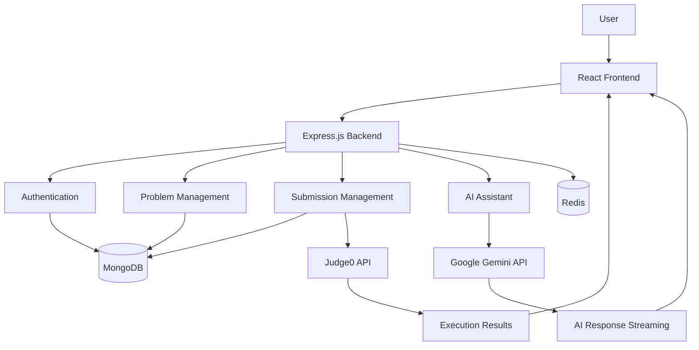

<div align="center">

# 🚀 AiCodezy

### AI-Powered Coding Practice Platform

**Practice. Code. Execute. Learn with AI.**

[](https://ai-codezy.vercel.app)
[](https://react.dev/)
[](https://nodejs.org/)
[](https://www.mongodb.com/)
[](https://ai.google.dev/)
[](https://judge0.com/)

</div>

---

## 📖 Overview

**AiCodezy** is a full-stack coding practice platform designed to help developers improve their Data Structures and Algorithms (DSA) skills through hands-on coding, real-time code execution, and AI-powered assistance.

It provides an interactive coding environment where users can solve problems, execute code against test cases, submit solutions, track their progress, and receive personalized guidance from an AI assistant.

The platform combines an interactive Monaco code editor, automated code evaluation using Judge0, and Google Gemini-powered AI assistance to create a complete coding practice experience.

---

## 📸 Screenshots

<div align="center">

### 🏠 Home Page


<br/>

### 📚 Problems Dashboard


<br/>

### 💻 Coding Workspace


<br/>

### 🤖 AI Coding Assistant


<br/>

### ⚡ Code Execution & Test Results

<table>
<tr>
<td width="50%" align="center">
<strong>Execution Results</strong><br/><br/>

</td>
<td width="50%" align="center">
<strong>Test Case Results</strong><br/><br/>

</td>
</tr>
</table>

<br/>

### 📊 Submission History


</div>

---

## ✨ Key Features

| Feature | Description |
|---|---|
| 🔐 **User Authentication** | Secure signup and login functionality. |
| 📚 **Problem Library** | Browse and practice a collection of DSA problems. |
| 💻 **Monaco Code Editor** | Interactive code editor for writing and editing solutions. |
| 🌐 **Multi-Language Support** | Solve problems using multiple programming languages. |
| ⚡ **Code Execution** | Run code against visible test cases and get instant feedback. |
| 🎯 **Code Submission** | Evaluate solutions against visible and hidden test cases. |
| 📊 **Submission History** | Track previous submissions and their execution results. |
| 🏆 **Solved Problems Tracking** | Keep track of successfully solved problems. |
| 🤖 **AI Coding Assistant** | Get AI-powered hints, explanations, and debugging assistance. |
| 📅 **Daily Problems** | Practice regularly with daily coding challenges. |
| 📖 **Editorials & Solutions** | Access problem explanations and solution resources. |

---

## 🏗️ System Architecture

AiCodezy follows a client-server architecture where the React frontend communicates with the Express.js backend through APIs.

The backend handles authentication, problem management, code submissions, database operations, and AI requests. External services such as Judge0 and Google Gemini provide code execution and AI-powered assistance.



---

## 📂 Project Structure

```text
AiCodezy/
│
├── Frontened/
│   ├── public/
│   ├── src/
│   │   ├── auth/
│   │   │   ├── authPage.jsx
│   │   │   ├── signIn.jsx
│   │   │   └── signUp.jsx
│   │   │
│   │   ├── components/
│   │   │   ├── answer.jsx
│   │   │   ├── askAI.jsx
│   │   │   ├── codeEditor.jsx
│   │   │   ├── dailyProblem.jsx
│   │   │   ├── description.jsx
│   │   │   ├── dsaVisualize.jsx
│   │   │   ├── editorial.jsx
│   │   │   ├── features.jsx
│   │   │   ├── footer.jsx
│   │   │   ├── hero.jsx
│   │   │   ├── solutions.jsx
│   │   │   ├── submissions.jsx
│   │   │   ├── testCaseResults.jsx
│   │   │   └── testCases.jsx
│   │   │
│   │   ├── pages/
│   │   │   ├── allProblems.jsx
│   │   │   ├── Home.jsx
│   │   │   ├── navbar.jsx
│   │   │   └── problemPage.jsx
│   │   │
│   │   ├── redux/
│   │   │   ├── aiChatslicer.js
│   │   │   ├── authSlicer.js
│   │   │   ├── dailyproblemSlicer.js
│   │   │   ├── problemSlicer.js
│   │   │   ├── problemSolvedslicer.js
│   │   │   ├── runsSlicer.js
│   │   │   └── submitSlicer.js
│   │   │
│   │   ├── shimmers/
│   │   ├── store/
│   │   ├── Ui/
│   │   ├── utils/
│   │   ├── App.jsx
│   │   ├── index.jsx
│   │   └── index.css
│   │
│   ├── index.html
│   ├── package.json
│   ├── tailwind.config.js
│   └── vite.config.js
│
├── server/
│   ├── src/
│   │   ├── config/
│   │   │   ├── db.js
│   │   │   └── redis.js
│   │   │
│   │   ├── controllers/
│   │   │   ├── aiChatController.js
│   │   │   ├── auth.js
│   │   │   ├── problemController.js
│   │   │   ├── submitController.js
│   │   │   └── videoSolutionCont.js
│   │   │
│   │   ├── middleware/
│   │   │   ├── adminmiddleware.js
│   │   │   └── tokenverify.js
│   │   │
│   │   ├── models/
│   │   │   ├── Problem.js
│   │   │   ├── submission.js
│   │   │   ├── user.js
│   │   │   └── videoSoltuion.js
│   │   │
│   │   ├── routes/
│   │   │   ├── aiChatRouter.js
│   │   │   ├── problemRouter.js
│   │   │   ├── submitProblem.js
│   │   │   ├── userAuth.js
│   │   │   └── videoRouter.js
│   │   │
│   │   └── utils/
│   │       ├── ProblemUtlis.js
│   │       └── validator.js
│   │
│   ├── index.js
│   └── package.json
│
├── package.json
├── package-lock.json
└── README.md
```

---

## 🛠️ Tech Stack

<div align="center">

### Frontend


### Backend


### AI & Code Execution


### Other Technologies


</div>

---

<div align="center">

### 🌐 Explore AiCodezy

**[🚀 Visit Live Application](https://ai-codezy.vercel.app)**

</div>
